<!-- Cards are animated SVGs drawn by scripts/render_cards.py and refreshed daily by
     .github/workflows/refresh-cards.yml. Spacing is baked into the SVGs, so keep this block
     free of blank lines and keep each row of cards on one line with no spaces between them. -->

 
 
 
 
 

<a href="https://gauravkhandelwal.codes">gauravkhandelwal.codes</a> &nbsp;/&nbsp; <a href="https://kampuskartmitadt.vercel.app">try KampusKart</a> &nbsp;/&nbsp; <a href="https://github.com/Gaurav-205?tab=repositories">all repos</a>

